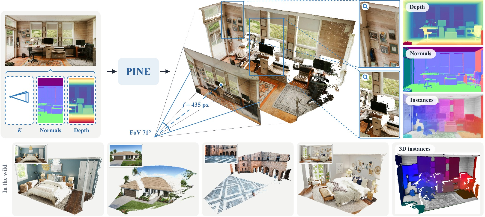

<p align="center">
  <h1 align="center">PINE: Point, Instance and Normal Estimation in One-Step Diffusion Model</h1>
  <p align="center">
    <a href="https://zephyr0609.github.io/">Zeyu Ren</a><sup>1</sup> &middot;
    Jie Ni<sup>2*</sup> &middot;
    Jiahao Wei<sup>3</sup> &middot;
    <a href="https://ha0tang.github.io/">Hao Tang</a><sup>4</sup>
    <br>
    Yongtai Liu<sup>5</sup> &middot;
    <a href="https://steve-zeyu-zhang.github.io/">Zeyu Zhang</a><sup>4&dagger;</sup> &middot;
    <a href="https://scholar.google.com/citations?hl=zh-CN&user=z3sAW3oAAAAJ">Rui Qian</a><sup>3*</sup>
  </p>
  <p align="center">
    <sup>1</sup>The University of Melbourne &nbsp; <sup>2</sup>Southeast University &nbsp; <sup>3</sup>Fudan University &nbsp; <sup>4</sup>Peking University &nbsp; <sup>5</sup>Hanyang University
  </p>
  <p align="center">
    <sup>*</sup>Corresponding authors &nbsp; <sup>&dagger;</sup>Project lead
  </p>
  <h3 align="center">
    <a href="https://aigeeksgroup.github.io/PINE/">Website</a> | <a href="https://huggingface.co/zeyuren2002/PINE">Weights</a> | <a href="MODELS.md">Models</a> | <a href="DATASETS.md">Datasets</a>
  </h3>
</p>

<p align="center">
  
</p>

PINE is a one-step Diffusion Transformer that predicts the point map, the surface normals and the instance map of an image in one forward pass. Each map is a token stream with its own input and output layers; the streams share the transformer blocks, and a stream mask decides which streams exchange tokens. A camera-aware ray encoding positions every token by its camera ray, and grounding attention adds the affinity of frozen DINOv3 features to the attention logits.

## Installation

This codebase is developed with Python 3.10, PyTorch 2.7.0, and CUDA 12.6.

We recommend setting up a virtual environment (e.g., [conda](https://docs.anaconda.com/miniconda/) or [venv](https://docs.python.org/3/library/venv.html)) before installation:

```bash
# conda
conda create -y -n pine python=3.10
conda activate pine

# or venv
# python -m venv /path/to/venv/pine
# source /path/to/venv/pine/bin/activate

# a recent pip is needed (pip 23 cannot read the metadata of current wheels)
pip install -U pip

# torch 2.7.0, cuda 12.6
pip install torch==2.7.0 torchvision==0.22.0 --index-url https://download.pytorch.org/whl/cu126

pip install -r requirements.txt

# DINOv3 encoder code (not vendored; built with torch.hub from a local checkout)
git clone https://github.com/facebookresearch/dinov3.git third_party/dinov3
```

All commands are run from the repository root, and the launch scripts in [scripts/](scripts).

The DINOv3 weights are gated and cannot be redistributed, so they are not part of the released
checkpoints. Request access on the
[official DINOv3 repository](https://github.com/facebookresearch/dinov3) and place the weights
under `pretrained/dinov3/` with their exact upstream filenames, or point `DINOV3_WEIGHTS_DIR` at
the directory holding them. They are needed for evaluation and the demo as well as for training;
see [MODELS.md](MODELS.md) for the file list.

## Model Zoo

Pre-trained models are available in the [Model Zoo](MODELS.md): PINE-B / L / H at `512×512`. All weights are hosted on
[Hugging Face](https://huggingface.co/zeyuren2002/PINE).

Download the weights and place (or symlink) them in the `pretrained` directory:

```bash
hf download zeyuren2002/PINE pine-l-512.pth --local-dir pretrained
```

The checkpoints ship without the frozen DINOv3 encoder, which is downloaded separately (see
[Installation](#installation)).

## Demo

Check [scripts/demo_l_512.sh](scripts/demo_l_512.sh) for running our pre-trained models on your own images, with no ground truth and no camera intrinsics required. Set `IMAGE_DIR` at the top of the script, or pass it as an environment variable:

```bash
IMAGE_DIR=assets/demo bash scripts/demo_l_512.sh
```

Any `.jpg`/`.png` files work, and nested folders are fine, since the loader globs recursively. For each image `name.png` the script writes `name_depth.png`, `name_normal.png`, `name_instance.png` and `name_pointcloud.ply`.

In Python:

```python
import torch
from util.checkpoint import load_model

model = load_model('pretrained/pine-l-512.pth')            # EMA weights, one sampling step
image = ...                                                 # (1, 3, H, W) in [-1, 1], H and W multiples of 16
with torch.amp.autocast('cuda', dtype=torch.bfloat16):
    maps = model.generate(image.cuda(), intrinsics=None)   # (1, 9, H, W): point map, normals, instance map
points, normals, instances = maps.float().chunk(3, dim=1)
normals = torch.nn.functional.normalize(normals, dim=1)
```

`intrinsics` is `None` for an unknown camera, or a `(1, 4)` tensor `(fx, fy, cx, cy)` in pixels of the input. The point map is affine-invariant (it has an unknown scale and an unknown shift); the demo script recovers the shift and the focal length for the point cloud (`util/self_calibration.py`).

## Dataset Preparation

See [DATASETS.md](DATASETS.md) for detailed instructions on preparing the 6 training datasets and the zero-shot evaluation benchmarks.

Symlink the prepared datasets to the `datasets` directory:

```bash
ln -s YOUR_DATASET_PATH datasets
```

## Evaluation

Evaluation scripts are provided in [scripts/](scripts) for reproducing the results in our paper:

```bash
bash scripts/eval_l_512.sh
```

Swap `l` for `b` or `h`. The script runs the protocols of the paper: point map and depth on seven datasets (with and without intrinsics), normals on four datasets, point-prompted instance segmentation on five benchmarks, and the field of view. [scripts/eval_ibims_planarity.py](scripts/eval_ibims_planarity.py) and [scripts/eval_inference_efficiency.py](scripts/eval_inference_efficiency.py) give the planarity and cost tables.

## Training

PINE is trained at `512×512` on the 6-dataset mixture, from the released PointDiT weights of the same size:

```bash
bash scripts/train_l_512.sh
```

The training scripts in [scripts/](scripts) contain the exact commands and hyperparameters used for the experiments in our paper. Please refer to them for detailed configurations. Before training, you need to download the DINOv3 weights (see [Installation](#installation)) and the PointDiT weights (see [MODELS.md](MODELS.md)), and prepare the datasets per [DATASETS.md](DATASETS.md).

The ablations of the paper change one flag of this command on the 2-dataset mixture (`dataloader/configs/two_datasets_512.yaml`): `--camera_positional_encoding` and `--camera_pe_sites` (camera-aware ray encoding), `--stream_attention` (stream mask) and `--dino_grounding` (grounding attention).

## License

This codebase is released under the Apache License 2.0 (see the `LICENSE` file at the root of
the repository). It contains code derived from PointDiT (Copyright 2026 Google LLC, Apache License 2.0) and
from other open-source projects, which remains under its original licenses; see
[THIRD_PARTY_NOTICES](third_party/THIRD_PARTY_NOTICES) for the full list and notices.

The released PINE model weights are for non-commercial use only, under the
[CC BY-NC 4.0](https://creativecommons.org/licenses/by-nc/4.0/) license.

## Citation

If you find this work useful, please consider citing:

```bibtex
@article{ren2026pine,
  title={PINE: Point, Instance and Normal Estimation in One-Step Diffusion Model},
  author={Ren, Zeyu and Ni, Jie and Wei, Jiahao and Tang, Hao and Liu, Yongtai and Zhang, Zeyu and Qian, Rui},
  year={2026}
}
```

## Acknowledgements

Our codebase builds upon several excellent open-source projects: [PointDiT](https://github.com/google-research/pointdit), [JiT](https://github.com/LTH14/JiT), [DINOv3](https://github.com/facebookresearch/dinov3), [gen2seg](https://github.com/UCDvision/gen2seg), [DSINE](https://github.com/baegwangbin/DSINE), [MoGe](https://github.com/microsoft/MoGe), [Depth Pro](https://github.com/apple/ml-depth-pro) and [utils3d](https://github.com/EasternJournalist/utils3d). We thank all the authors for their great work.
